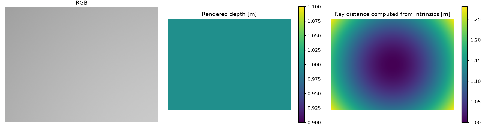
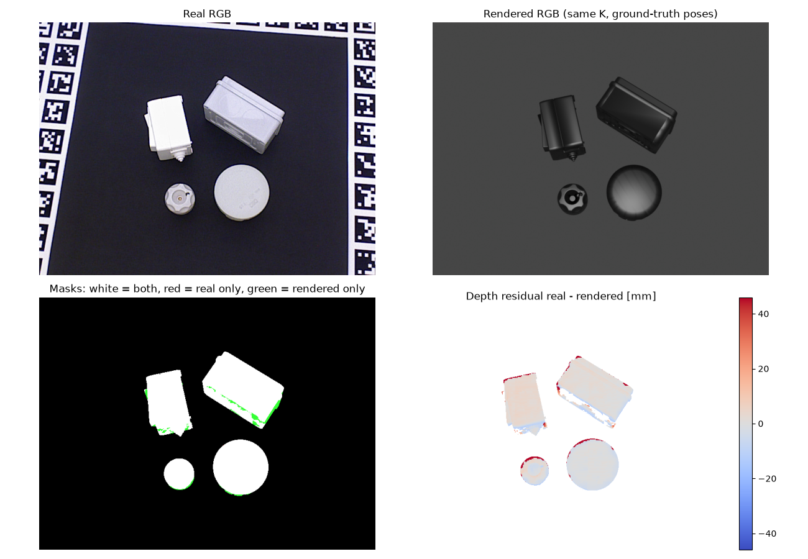
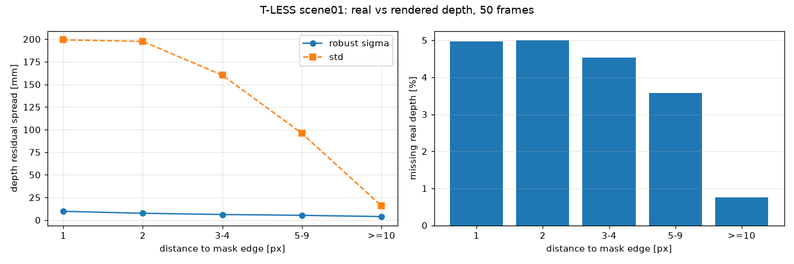

# Synthetic-to-Real Data Pipeline for Industrial Perception

**Status: version v1.0.** Phases 1 to 3 complete (environment, verified renderer conventions,
real-vs-rendered analysis on T-LESS). No model results yet.

Research question: how can synthetic image and 3D sensor data generated in simulation
be made realistic enough to support industrial object perception models on real data?

Renderer: BlenderProc (CPU rendering, Blender 4.2.1). Scenes are described in renderer-independent
job files; render scripts only read jobs and write images, so the renderer can be replaced.

## Key results

- Re-rendered 50 real T-LESS frames at their ground-truth poses: rendered silhouettes match the
  benchmark exactly (IoU 1.000 on 131 unoccluded instances) after correcting a half-pixel convention.
- Real depth deviates mainly at part edges: 4.97 % missing depth at the boundary vs 0.75 % inside,
  and about one boundary pixel in five reports the background, more than 50 mm behind the part.
- 300 randomized physics scenes, every labelled instance validated against its CAD model (median
  distance 0.164 mm). The whole pipeline runs from one script and reproduces the committed results exactly.

## Setup

Tested on Windows 11, Python 3.12.16, Blender 4.2.1 (downloaded by BlenderProc), CPU rendering only.

```
conda create -n sip -c conda-forge --override-channels python=3.12 pip -y
conda activate sip
python -m pip install -r requirements-lock.txt
python -m pip install -e ".[dev]"
python -m pytest
blenderproc quickstart
```

`blenderproc quickstart` downloads Blender on first use and renders a test image.

Dataset: download `tless_base.zip`, `tless_models.zip` and `tless_test_primesense_bop19.zip` from the
BOP mirror listed in `docs/datasets.md` (check the SHA-256 hashes there), extract them into `data/raw/`,
and arrange them as `data/raw/tless/` with `models_cad/`, `models_eval/`, `models_reconst/` and
`test_primesense/` inside. The data is not part of this repository.

## Repository structure

| Path | Contents |
| --- | --- |
| `src/synperc/processing/` | Camera geometry (`projection.py`), BOP loader (`bop.py`), annotation checks (`annotations.py`) |
| `src/synperc/evaluation/` | Mask IoU, centroid offset, depth residual statistics (`compare.py`), edge distance (`edges.py`) |
| `src/synperc/generation/` | Seeded random scene sampler (`sampling.py`) |
| `src/synperc/sensors/` | RANSAC plane fit and per-pixel plane depth (`plane.py`) |
| `scripts/render_*.py` | Run inside Blender with `blenderproc run`; read job files, write renders |
| `scripts/*.py` (others) | Run in the Python environment: job creation, statistics, validation, plane fits |
| `scripts/run_pipeline.ps1` | Runs everything end to end and compares with the committed results |
| `configs/` | Scene generation configurations v1 to v3 (v3 is current) |
| `tests/` | 42 unit tests, including closed-form geometry checks |
| `results/` | Committed figures, tables and plane fits |
## Phase 1: verified tools

- BlenderProc's depth output is planar depth: a plane rendered at 1.000 m reads 1.000000 m in every
  pixel. Mistaking a ray-distance image for depth in this setup (640 x 480, f = 500 px) would bend
  the plane with 63.0 mm RMS. See `results/phase1/plane_depth_check.png`.
- Open3D's voxel downsampling places its grid origin half a voxel below the minimum point.



## Phase 2: real T-LESS frames vs renders at ground-truth poses

T-LESS test scene 1 (PrimeSense sensor): 50 frames, 200 object instances, about 2.0 million pixels.
Each frame is re-rendered with its own intrinsics and the ground-truth poses, then compared pixel by pixel.

**Geometry.** Rendering with the benchmark's K placed every silhouette 0.5 px right and down
(pixel-centre convention). After shifting the principal point by -0.5 px in the Blender backend,
all 131 unoccluded instances match the benchmark's full masks exactly: IoU min 1.000, largest
centroid offset 0.03 px.



**Depth residual, real minus rendered**, on the rendered visible masks:

| Distance to mask edge | Missing depth | Median | Robust sigma | Residual > +50 mm |
|---|---|---|---|---|
| 1 px | 4.97 % | -3.65 mm | 9.68 mm | 19.48 % |
| 2 px | 5.00 % | -3.20 mm | 7.54 mm | 14.20 % |
| 3-4 px | 4.53 % | -2.59 mm | 6.17 mm | 7.69 % |
| 5-9 px | 3.57 % | -1.33 mm | 5.24 mm | 1.99 % |
| >= 10 px | 0.75 % | +0.20 mm | 3.90 mm | 0.08 % |



Findings:
- Near part boundaries the real sensor frequently reports the background: one in five boundary
  pixels lies more than 50 mm behind the part surface. These outliers dominate the standard
  deviation (81.7 mm overall vs a robust sigma of 4.58 mm), so robust statistics are reported.
- The benchmark's visible masks (`mask_visib`) come from a one-sided depth test: inside them only
  0.03 % of residuals are below -15 mm, while 98 % of the excluded pixels are. Residuals far behind
  the model are kept. Evaluating depth only inside `mask_visib` therefore hides one kind of error.
- Per-instance median offsets spread by 2.29 mm (robust), range -7.3 to +5.3 mm, consistent with
  small ground-truth pose errors. Removing them lowers the interior robust sigma from 3.90 to
  2.63 mm. That value is an upper bound on sensor noise at about 0.75 m: it still contains pose
  rotation errors and CAD-vs-part differences.

See `results/phase2/` for figures and the per-instance table.

## Phase 3: randomized synthetic scenes

Configuration `configs/generation_v3.yaml`, seed 2026: 300 scenes, each with 3 to 6 T-LESS parts
(objects 2, 25, 29, 30) dropped onto a table with rigid-body physics; random grey level, roughness and
metallic value per part; 1 to 3 point lights; camera at 0.65 to 0.90 m and 45 to 85 degrees elevation.
Each scene stores RGB, depth, instance segmentation, the final model-to-camera poses (OpenCV frame,
metres) and every sampled parameter. Generation is deterministic: the same seed reproduces the same
physics result and the same depth, down to the micrometre.

**Validation**, for every visible instance (1,368 of 1,387): the rendered depth of the labelled pixels,
back-projected and mapped into the model frame with the exported pose, lies on the CAD surface with a
median distance of 0.164 mm (largest per-instance median 0.462 mm). That is within the bound expected
from sampling depth inside a pixel, half the pixel diagonal: about 0.49 mm at 0.75 m and 0.59 mm at
0.9 m. No part left the table.

**Problems found and fixed during generation:**
- Segmentation configured before the objects existed labelled every pixel as background. Fixed by
  ordering, plus a guard that stops generation if a scene has parts but no labelled pixels.
- Overlapping start positions let the physics solver push a part through the infinitely thin table.
  Fixed by stacking drop heights further apart than the largest part's bounding-sphere diameter, and
  by using a 10 cm thick table.

**Brightness vs real T-LESS scene 1** (grey level 0 to 255, median): parts 162 vs 169, background
93 vs 42. The background is still too bright. Reducing ambient light six-fold barely changed it, which
ruled that out as the main cause. Blender's view transform is Filmic, a tone curve that compresses
contrast and lifts dark values; switching to Standard is the next thing to test. Tuning was stopped
after a fixed number of iterations (v1 to v3) by design.

**Observation:** render time per scene grew from about 5 s to about 32 s over one 300-scene Blender
session (also seen, less strongly, in the 50-frame replica run). Likely cause: state accumulating in a
long session. Mitigation: render in batches of separate processes.

```
python scripts/make_random_jobs.py configs/generation_v3.yaml --count 300 --out-root data/synthetic/gen_v3
blenderproc run scripts/render_random_scenes.py data/synthetic/gen_v3 "scene_*"
python scripts/validate_scenes.py data/synthetic/gen_v3 "scene_*"
python scripts/compare_brightness.py data/raw/tless data/synthetic/gen_v3 "scene_*"
```
## Phase 4 (first step): the real support plane

RANSAC plane fits on real depth outside the parts (5 px margin), per frame. 42 of 50 frames were
accepted (inlier fraction 63 to 100 %, inlier RMS 1.2 to 1.6 mm). The 8 lowest-elevation frames
locked onto walls or other surfaces (8 to 16 % inliers) and were rejected. In BOP's world frame the
table is the plane z = 0 (offset 0.35 mm), and the accepted fits agree with the consensus to a median
of 0.56 degrees and 0.33 mm (max 0.98 degrees, 0.79 mm). The consensus plane is carried into all 50
camera frames with the benchmark's camera poses.

## Not done

- Sensor noise model: measured (Phase 2) and designed (interior noise, edge dropout, background
  bleeding, edge bias), but not implemented or validated.
- No detector trained, no FID or KID, no Isaac Sim (no NVIDIA GPU available), only T-LESS scene 1
  and the PrimeSense sensor.
- Background brightness gap not resolved; Blender's Filmic tone curve is the suspected cause.

## Run everything

```
.\scripts\run_pipeline.ps1 -RunDir data\runs\check -RandomScenes 10
```

Runs the tests, the 50-frame replica comparison, the plane fits, 10 random scenes with validation and
brightness comparison, and compares the fresh results with the committed ones. About 15 minutes on a
laptop CPU. Exact dependency versions: `requirements-lock.txt`.
## Reproduce

```
python -m pytest
python scripts/make_replica_job.py data/raw/tless --all
blenderproc run scripts/render_jobs.py data/synthetic "replica_s01_im*"
python scripts/scene_replica_stats.py data/synthetic "replica_s01_im*" data/raw/tless
python scripts/analyze_replica_residuals.py data/processed/scene01_replica_pixels.npz
```

Dataset source, license and file hashes: `docs/datasets.md`.

## References and license

- T. Hodan, P. Haluza, S. Obdrzalek, J. Matas, M. Lourakis, X. Zabulis. *T-LESS: An RGB-D Dataset for
  6D Pose Estimation of Texture-less Objects.* WACV 2017.
- T. Hodan et al. *BOP: Benchmark for 6D Object Pose Estimation.* ECCV 2018.
- M. Denninger et al. *BlenderProc2: A Procedural Pipeline for Photorealistic Rendering.* Journal of
  Open Source Software 8(82), 2023.

No license file is included, so the code is all rights reserved. The T-LESS data is not redistributed
here; see `docs/datasets.md` for its source, license and attribution.